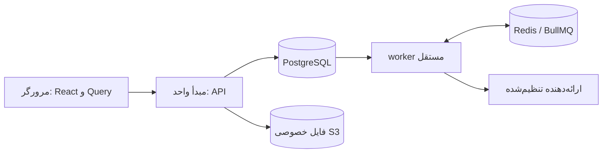

# معماری فعلی سامانه

تطبیق با کد: **2026-10-30**؛ مهاجرت‌های موجود تا `016_feedback_notifications.sql`. [تاریخچه تفصیلی مراحل](archive/ARCHITECTURE_HISTORY_2026-10.md).

## اجزا و جریان داده

## مدرسهٔ نمونهٔ توسعه

`npm run db:seed:full-demo` یک‌بار و فقط روی PostgreSQL توسعهٔ محلی `localhost:55432/schools` یک دبیرستان نمونه در سال شمسی جاری می‌سازد: سه پایه، دو کلاس در هر پایه، ۶۰ دانش‌آموز، برای هر دانش‌آموز یک حساب ولی و یک حساب دانش‌آموز، ۱۰ دبیر موضوعی، مدیر، دو معاون، مدیر پلتفرم، برنامهٔ پنج‌روزهٔ بدون تداخل، نمره، حضورهای تاریخی، تکلیف و تحویل، آزمون، تعرفه و ماندهٔ مالی نمونه، اطلاعیه و سؤال تمرینی. رمزها و شناسه‌های ورود در `.local/full-demo-school-credentials.md` نوشته می‌شوند؛ مسیر `.local/` در Git نادیده گرفته شده است. Seed در شروع سرور اجرا نمی‌شود، روی production رد می‌شود و اجرای دوباره برای جلوگیری از مدرسهٔ تکراری متوقف می‌شود. داده‌ها ساختگی‌اند و پیامک/اعلان بیرونی ارسال نمی‌شود.

| بخش | پیاده‌سازی |
| --- | --- |
| رابط | React 19، TypeScript، Vite 6، Tailwind 4، lucide-react و Motion؛ RTL و فونت فارسی محلی |
| داده رابط | TanStack Query در حافظه؛ AppContext همچنان adapter مجموعه‌ها، عملیات و وضعیت مشترک است و کاملاً تفکیک نشده |
| API | Fastify، اعتبارسنجی Zod و OpenAPI؛ `/api/v1` در مبدأ واحد |
| پایگاه داده | PostgreSQL، Drizzle همراه SQL و مهاجرت‌های SQL نسخه‌دار |
| کار پس‌زمینه | worker مستقل؛ Redis/BullMQ برای outbox و پردازش دسته‌ای jobهای اعلان در PostgreSQL |
| فایل | S3/MinIO خصوصی، فراداده و مجوز در PostgreSQL |

صفحه عمومی `/` بدون دانلود پنل‌ها و وابستگی داده‌ای به API است؛ `/login` و داشبوردها lazy هستند. پورت عمومی 3000 و میزبان توسعه 0.0.0.0 ثابت‌اند؛ Vite در توسعه API را به 3001 پراکسی می‌کند. در تولید Fastify رابط ساخته‌شده و API را روی 3000 ارائه می‌دهد.

خرابی API، داده نمونه یا localStorage را جایگزین نمی‌کند. کش خصوصی پایدار در مرورگر نداریم؛ تغییر حساب/عضویت درخواست‌ها را لغو و کش را پاک می‌کند. فرم باز تا تأیید سرور حفظ می‌شود؛ این قابلیت ذخیره دائمی پیش‌نویس یا همگام‌سازی آفلاین نیست.

## راهنمای داخل برنامه

SystemDocsModal از TeachingDialog مشترک و portal، قفل اسکرول، کنترل فوکوس و Escape استفاده می‌کند. محتوای ثابت و نوع‌دار در src/content/systemGuide.ts نگه‌داری می‌شود و با بازشدن راهنما به‌صورت lazy بارگذاری می‌شود؛ خواندن راهنما درخواست API یا تغییر scope/مجوز ایجاد نمی‌کند. انتخاب نقش در راهنما فقط متن را عوض می‌کند.

چهار بخش شروع کار، امکانات، دسترسی‌ها و درباره سامانه، جست‌وجوی فارسی با یکسان‌سازی ی/ک، دسته‌بندی، پرسش رایج و وضعیت موجود/نیازمند تنظیم/آینده دارند. جدول عریض دسترسی به کارت‌های نقش تبدیل شده است. کپی از همین محتوا تولید و شکست clipboard با انتخاب دستی متن نمایش داده می‌شود؛ چاپ به بخش فعلی پنجره محدود است. تاریخ نسخه محتوا صریح است و از زمان بازکردن صفحه ساخته نمی‌شود. تغییر گردش‌کارها باید هم این منبع و هم مستندات MD را به‌روز کند؛ همگام‌سازی خودکار MD با رابط ادعا نمی‌شود.

## مدل داده

| حوزه | جدول‌ها و مرز |
| --- | --- |
| هویت | users، memberships، sessions، challenges؛ فرد از نقش/مدرسه/فرزند جداست |
| مدرسه | schools، academic_years، enrollment_identities؛ ثبت‌نام و سابقه سالانه مستقل |
| عملیات مدرسه | records با school/year/kind و FKهای کلاس/دانش‌آموز/دبیر؛ فیلدهای دامنه در JSONB |
| آموزش دبیر | classroom_events و سوابق نسخه‌دار مرتبط؛ مشارکت درس از انضباط رسمی جداست |
| محتوا و فایل | regional_content، files، support_attachments |
| صحت عملیات | idempotency، audit_log، outbox |
| محدودیت مدرسه | school_access_policies و school_access_history |
| پشتیبانی | support_tickets، support_replies؛ مالک، مدرسه و مسئول رسیدگی |
| پیام شخصی | inbox_messages، inbox_recipients؛ مقصد عضویت مشخص و وضعیت خواندن/کانال مستقل |
| انتشار عمومی در زنگوله | announcement_jobs با cursor و ارسال دسته‌ای |
| بله | bale_links و bale_pairings؛ اتصال تأییدشده حساب، مستقل از اطلاعات تماس پرونده |
| آمار | analytics_events، analytics_collection، analytics_retention |

records به جدول‌های کاملاً جدا برای هر نوع تبدیل نشده است. خلاصه مالی، سوابقی از پرونده و کارنامه در JSONB ثبت‌نام همان سال باقی‌اند. هویت انتقالی، مجوز خودکار دسترسی به مدرسه مبدأ ایجاد نمی‌کند. سال و معدل داده قدیمی از روی حدس ساخته نمی‌شوند.

## مجوزها

| نقش | محدوده سرور |
| --- | --- |
| مدیر پلتفرم | مدارس، حساب مدیران، محتوا، سیاست مدرسه، پشتیبانی و آمار؛ خدمت نظارتی صریحِ فقط خواندنی برای جزئیات مدارس |
| مدیر مدرسه | مدیریت مدرسه خود؛ مجوز منطقه‌ای یا ورود به‌جای کاربر دیگر ندارد |
| معاون | فقط مجوزهای واگذارشده؛ از جمله canManageAnnouncements برای ارسال پیام |
| دبیر | ترکیب واقعی مدرسه/سال/کلاس/درس و مالکیت فعالیت؛ عملکرد همان درس، نه پرونده عمومی خانواده/مالی |
| دانش‌آموز | ثبت‌نام متصل خودش و محتوای مجاز |
| ولی | فرزند متصل در عضویت انتخابی و محتوای مجاز |

URL، هدر مدرسه/سال، role دلخواه یا شناسه مقصد مجوز ایجاد نمی‌کنند. RLS اجباری روی جداول مدرسه‌ای و دامنه‌های خصوصی مربوط اعمال می‌شود؛ همه جدول‌های برنامه به یک سیاست واحد متکی نیستند. حساب اجرایی school_app مالک جدول یا دارای BYPASSRLS نیست.

transaction تو در تو اتصال و scope بیرونی را بازاستفاده می‌کند؛ دامنه را خودکار ارتقا نمی‌دهد. خدمت نظارتی پس از کنترل platform_admin، مدرسه/سال هدف را صریحاً در همان تراکنش تنظیم می‌کند. این خدمت رمز، کد، نشست یا اختیار نوشتن مدرسه را باز نمی‌کند. مشاهده پرونده/بخش‌ها و شروع دانلود رسید ممیزی می‌شوند.

## هویت و سیاست مدرسه

رمز Argon2id، نشست قابل ابطال سمت سرور و کوکی HttpOnly/SameSite=Lax و Secure در تولید است. رمز/توکن در localStorage نیست. Origin و CSRF برای عملیات لازم کنترل می‌شوند. ورود با رمز یا پیامک مستقل است؛ مدیر هم بعد از رمز، مرحله پیامکی اجباری ندارد. کد ورود پنج دقیقه اعتبار دارد. تغییر رمز/بازیابی/شماره احراز هویت، نشست‌های قبلی را باطل می‌کند؛ تغییر تماس پرونده چنین تغییری نیست.

در development، localhost و IP واقعی شبکه همین میزبان روی پورت 3000 برای Origin مجازند؛ تولید فقط APP_ORIGIN تنظیم‌شده را می‌پذیرد.

وضعیت مدرسه از فعال‌بودن حساب جداست: active، read_only و suspended، با علت، پایان اختیاری، نسخه و تاریخچه. guard سرور و قفل سیاست، ثبت مدرسه محدودشده را می‌بندند. ورود، امنیت حساب، تیکت، دریافت/خواندم پیام و telemetry محدود، استثناهای صریح‌اند. تعلیق داده مدرسه را پشت ظاهر مخفی بارگذاری نمی‌کند؛ AppProvider کنار می‌رود و صفحه محدودیت/پیگیری می‌آید. دیگر عضویت‌های فرد و معرفی مستقل دانا پلاس به تعلیق همان مدرسه وابسته نیستند.

## صحت عملیات و دریافت داده

- حضور مدرسه/سال/کلاس/روز/زنگ و برنامه کلاس/دبیر در همان روز/زنگ قید یکتا دارند. اصلاح حضور گذشته علت، نسخه و اعضای تاریخی همان جلسه را حفظ می‌کند.
- notifyParents انتخاب واقعی دبیر است؛ تغییر این گزینه به‌تنهایی پیام قبلی را تکرار نمی‌کند. «همیشه ارسال» جایگزین انتخاب محصول نمی‌شود.
- مالی با قفل حساب دانش‌آموز و تراکنش انجام می‌شود؛ درخواست هم‌زمان نباید اضافه‌پرداخت بسازد. مقدار پول تومان صحیح در محدوده امن است.
- دفتر نمره از کارنامه رسمی جداست؛ فرمول معدل حدس زده نمی‌شود. انتشار و ارتقا تابع داده معتبر کارنامه‌اند.
- فهرست‌های عمومی limit/offset، پیش‌فرض ۲۵ و سقف ۱۰۰ دارند؛ میز کار، پیام، تیکت و نظارت سقف‌های اختصاصی دارند. آمار کل از یک صفحه فهرست حساب نمی‌شود.
- تازه‌سازی عملیات مستقل فقط منابع مرتبط را هدف می‌گیرد؛ موفقیت commit از شکست refetch پس‌زمینه جداست. مالی/حضور/چرخه سال همچنان روش گسترده‌تر قبلی را دارند.

## فایل، پشتیبانی و پیام

فایل حداکثر دو مگابایت است؛ نوع/محتوا بررسی و تصویر با سقف پیکسل به WebP بهینه می‌شود. فایل اجرایی و HTML/SVG پذیرفته نیست؛ اسکن مستقل ضدبدافزار ادعا نمی‌شود. فایل مدرسه scope سال دارد؛ پیوست تیکت مستقل از سال و در تعلیق قابل استفاده است، با سقف ده فایل، digest/idempotency آپلود و مجوز تیکت. دانلود خصوصی است. رسید نظارتی باید هم در مالی همان پرونده ارجاع شده باشد و هم metadata همان مدرسه/سال/فرد را داشته باشد.

تیکت برای مالک همان مدرسه و پلتفرم مجاز است. ارجاع فقط به مدیر پلتفرم فعال است و در زنگوله او ثبت می‌شود. پاسخ پشتیبانی نیز اتمیک به صندوق صاحب تیکت می‌رود.

زنگوله شخصی از تاریخچه قدیمی ارسال جداست. read_at، sms_status و bale_status مستقل‌اند. فرستنده مستقیم مدیر پلتفرم/مدیر/معاون مجاز یا دبیر با کلاس/درس معتبر است؛ مقصد حداکثر ۵۰ عضویت مجاز و فعال است. یک متن برای چند عضویت یک فرد، کانال بیرونی را یک‌بار صف می‌کند. دانستن شماره یا شناسه بله پرونده، مجوز پیام مستقیم به حساب احراز‌شده نیست.

notifyInbox هنگام انتشار جدید، پیام عمومی و job را در تراکنش می‌سازد. worker حداکثر پنج دسته ۲۰۰ عضوی در نوبت تحویل می‌دهد؛ بایگانی/تغییر مخاطب یا ابطال اختیار، ادامه ارسال را متوقف می‌کند. ویرایش/سنجاق/retry پیام گروهی تازه نمی‌سازند. خطای ارسال بیرونی، ثبت آموزشی/مالی یا پیام داخلی را پس نمی‌گیرد.

بله شخصی با کد هش‌شده ۱۲۸بیتی ده‌دقیقه‌ای، /start خصوصی و وب‌هوک با secret مستقل متصل می‌شود. unlink، ارسال معلق به ارتباط قبلی را نامعتبر می‌کند. ارسال زنده و پذیرش ارائه‌دهنده به تنظیم واقعی وابسته‌اند؛ «در صف» یا «پذیرفته‌شده» معادل خوانده‌شدن/تحویل قطعی نیست.

## آمار و عملیات

رویدادها زمان UTC و روز تهران دارند؛ هویت/مدرسه/نقش از سرور می‌آید. نمایش تبلیغ به ۵۰٪ کارت برای یک ثانیه در صفحه فعال وابسته است. بازشدن معرفی دانا پلاس، خرید دوره نیست. حذف تکرارِ روزانه فعالیت، نیم‌ساعته نمایش/معرفی و دوثانیه‌ای کلیک، همراه event_id انجام می‌شود. فعالیت پلتفرم در آمار مصرف وارد نمی‌شود.

collector فقط حافظه‌ای، محدود و best-effort است؛ یک retry شبکه/۵xx دارد و UI منتظرش نمی‌ماند. گزارش تجمیعی ۱ تا ۹۰ روز است؛ کاربران یکتا در کل بازه از جمع نقش/روز جدا هستند. شمارنده تجمیعی قدیمی بنر جدا می‌ماند و گذشته بازسازی نمی‌شود. سیاست خام پیش‌فرض فعال ۱۸۰ روز، قابل تغییر ۹۰ تا ۷۳۰ و قابل توقف است؛ حذف دسته‌ای با worker انجام می‌شود و بازگردانی خودکار ندارد.

health/readiness، سنجه محافظت‌شده و پشتیبان رمزگذاری‌شده وجود دارند؛ فعال‌سازی timer/هشدار و بازیابی عملیاتی مسئولیت محیط مقصد است. وجود این اجزا تضمین ظرفیت یا آمادگی تولید نیست. [استقرار](DEPLOYMENT.md)، [عملیات](OPERATIONS_SETUP.md) و [دامنه بررسی](VALIDATION.md) جزئیات را مشخص می‌کنند.

## هدر مشترک — 2026-10-30

Header در هر شش نقش نوار ثابت ۶۴ پیکسلی با نام ثابت دانا، مدرسه/نقش/سال، زنگوله و حساب دارد. انتخاب نام نمایشی حذف شد؛ انتخاب مدرسه از عضویت‌های مجاز همچنان مستقل است. پنجره‌های حساب، مدرسه و پیام‌ها با TeachingDialog در portal باز می‌شوند؛ روی موبایل از پایین و با ارتفاع محدود به viewport، اسکرول داخلی، قفل اسکرول زمینه و مدیریت فوکوس/کلید Escape. گزینه اختیاری dismissOnBackdrop فقط برای این پنجره‌ها فعال است و پیش‌فرض سایر فرم‌ها تغییر نکرده است.

## صدای مدرسه — 2026-10-30

migration 014 چهار جدول school_feedback، school_surveys، survey_recipients و survey_responses با RLS مدرسه‌ای اضافه می‌کند. API /community زیر wrapper تراکنش، CSRF، Idempotency-Key و سیاست تعلیق/فقط‌خواندنی است. پیشنهاد مستقل از سال و نظرسنجی وابسته به سال است. نمایش مدرسه فقط projection فاقد شناسه مالک برای پیام ناشناس دارد؛ endpoint شناسایی فقط platform_admin است و دلیل حداقل ده‌حرفی را در audit ثبت می‌کند. هویت در DB موجود است و این قابلیت ناشناس‌بودن در برابر مدیر پلتفرم نیست.

مجوزهای canManageFeedback و canManageSurveys مستقل و برای معاون پیش‌فرض فاقد دسترسی‌اند. مدیر مدرسه مدیریت و پلتفرم نظارت دارد. انتشار مخاطبان فعال را برای نقش‌های student/parent/teacher و کلاس‌های منتخب snapshot می‌کند و در همان تراکنش inbox با kind=survey و دکمه ورود می‌سازد؛ این مسیر ارسال خارجی ندارد. پس از انتشار سؤال ثابت، وضعیت published سپس closed، و پاسخ یکتای هر عضویت با کنترل قفل و نوع پاسخ است. عضویت ولیِ هر فرزند مستقل است. نتایج در SQL تجمیع و پاسخ فردی با صفحه ۲۵تایی خوانده می‌شود.

CommunityPanel با ورودی مستقل پیشنهاد/نظرسنجی استفاده می‌شود؛ زیر تبلیغ فقط کارت نظرسنجی بازِ مخاطب نمایش دارد. دریافت‌ها Query و scoped به عضویت/سال‌اند؛ فرم باز در خطای شبکه حفظ و کلید عملیات برای retry همان بدنه نگه داشته می‌شود. پاسخ نظرسنجی با نام است و این موضوع پیش از پاسخ نمایش داده می‌شود.

## تفکیک ورودی پیشنهاد و نظرسنجی و کنترل انتخاب — 2026-10-30

CommunityPanel با mode مستقل feedback/surveys باز می‌شود؛ تب مشترک حذف شده است. منوی حساب ورودی پیشنهادها را فقط برای فرستنده یا مسئول مجاز و مدیریت نظرسنجی را فقط برای مدیر/معاون مجاز/پلتفرم نشان می‌دهد. زیر تبلیغ، GET /community/surveys?pending=true فقط نظرسنجی published و فاقد پاسخ همان عضویت را پیش از pagination فیلتر می‌کند. نبود نتیجه، بارگذاری یا خطای دریافت، کارت عمومی ایجاد نمی‌کند. بخش فشرده هر ۳۰ ثانیه تازه می‌شود و پس از ارسال موفق نیز invalidate می‌شود؛ اعلان انتشار و ورود مستقیم زنگوله حفظ‌اند.

CSS عمومی ورودی متنی TeachingDialog از checkbox/radio مستثنا شد. نشان انتخاب بومی ۱۸ پیکسل و غیرکشسان است؛ ناحیه label حداقل ۴۴ پیکسل باقی می‌ماند. فوکوس و وضعیت disabled حفظ‌اند؛ کنترل‌های بصری سفارشی و sr-only تغییر نمی‌کنند.

## دوره ارزشیابی دبیران — migration 015

school_surveys.kind سه نوع standard/evaluation/evaluation_item دارد. دوره اصلی evaluation فقط تنظیم پرسش و کلاس‌های مقصد است؛ انتشار تراکنشی، تخصیص‌های واقعی records.teachers.data.assignedClassIds در همان مدرسه/سال را به آیتم یکتای parent/teacher/class تبدیل می‌کند. نام دبیر و کلاس، پرسش‌ها و مخاطبان هنگام انتشار snapshot می‌شوند؛ تخصیص خالی خطا می‌دهد و با حدس تکمیل نمی‌شود. FKهای مرکب مدرسه/سال و RLS قبلی حفظ‌اند.

دانش‌آموز در آیتم فقط با عضویت مخاطب همان کلاس مجاز است. پاسخ مستقیم دوره اصلی پذیرفته نیست. تکمیل دوره یعنی همه آیتم‌های مجاز آن عضویت پاسخ گرفته‌اند؛ کارت pending تا آن زمان باقی می‌ماند. تنها یک پیام زنگوله برای دوره ساخته می‌شود. بستن دوره، آیتم‌ها را همان تراکنش می‌بندد؛ قفل ثبت پاسخ/بستن روی آیتم مشترک است. GET targets صفحه ۲۵تایی و شمار پیشرفت دارد؛ پاسخ موفق به دبیر بعدی می‌رود و خطای ثبت، فرم را نگه می‌دارد.

نتایج دوره آیتم‌ها را بدون شمارش دوباره مخاطبان دوره تجمیع می‌کنند؛ teacherId/classId گزارش کل مدرس، یا مدرس در یک کلاس، و پاسخ‌های فردی را محدود می‌کنند. تعداد پاسخ/مخاطب در کل دوره تعداد ارزیابی است، نه افراد یکتا.

ورودی پیشنهاد و نظرسنجی مدیر/معاون از هدر به SchoolOperationsDashboard منتقل شد. canManageFeedback و canManageSurveys در ابزار و سرور مستقل‌اند؛ تنظیم هر دو در VicePrincipalPermissionsModal توسط مدیر انجام می‌شود.

## بازبینی نظرسنجی و پیشنهادها — 2026-10-30

CommunityPanel اکنون router رابط است: FeedbackWorkspace دریافت/رسیدگی پیام‌ها و SurveyWorkspace ساخت/پاسخ/گزارش را نگه می‌دارند؛ SurveyReport نمایش آماری مستقل است. پیشنهادهای پلتفرم فقط از کارت یا نمای نظارت همان مدرسه باز می‌شوند؛ schoolContext بخشی از کلید کش است و schoolId برای GET فهرست/جزئیات پیشنهادهای پلتفرم الزامی است. نظرسنجی پلتفرم نیز schoolId و yearId اختیاری دارد؛ فهرست عمومی تمام مدارس از هدر حذف شد. این جابه‌جایی نقش پلتفرم را به مدیر مدرسه تبدیل نمی‌کند.

فیلتر new/reviewed و search در SQL قبل از pagination هستند. PATCH پیشنهاد version دارد، reply اختیاری اما اگر ارسال شود حداقل سه حرف است، و status مستقل است. پاسخ تغییرکرده در همان تراکنش پیام kind=feedback برای عضویت اصلی فرستنده می‌سازد؛ وضعیت یا متن یکسان و retry همان عملیات اعلان تازه ایجاد نمی‌کند. پیام زنگوله متن پاسخ و هویت ناشناس را حمل نمی‌کند؛ خواندن جزئیات مجوز مستقل دارد. migration 016 نوع پیام و ایندکس وضعیت مدرسه را اضافه می‌کند. شناسایی ناشناس همچنان فقط پلتفرم با دلیل و audit است.

ذخیره پیش‌نویس از انتشار جداست؛ PATCH draft→draft مجاز و انتشار با مرور مخاطب/پرسش و تأیید جدا انجام می‌شود. انتشار بدون مخاطب فعال rollback می‌شود. پاسخ‌های ناتمام به تفکیک شناسه نظرسنجی/دبیر در حافظه نگه داشته می‌شوند؛ جابه‌جایی یا تلاش مجدد آن‌ها را پاک نمی‌کند. بستن پنجره دارای متن ثبت‌نشده هشدار محصولی دارد؛ refresh یا خروج ذخیره پایدار ایجاد نمی‌کند. فرم‌ها هنگام mutation غیرفعال و دریافت مجدد پس‌زمینه از موفقیت ثبت جداست.

گزارش امتیازی میانگین از پنج و تعداد پاسخ دارد؛ توزیع تعداد امتیازها اختیاری است و درصد ندارد. چندگزینه‌ای درصد از پاسخ‌های همان سؤال دارد؛ متن خالی امتیاز صفر نیست و میانگین بدون پاسخ خط تیره است. کل دوره ارزشیابی همچنان تعداد ارزیابی‌ها را می‌شمارد، نه افراد یکتا.

## منبع مشترک اختیارات معاون

src/content/vicePrincipalPermissions.ts فهرست نمایشی مشترک StaffManagerModal (مسیر واقعی کادر و دسترسی‌ها) و VicePrincipalPermissionsModal است. هر دو، مجوز پیشنهادها و نظرسنجی را نمایش می‌دهند. شمار مجوز از همین فهرست محاسبه می‌شود؛ backend و schema مجوزها تغییر نکردند.
